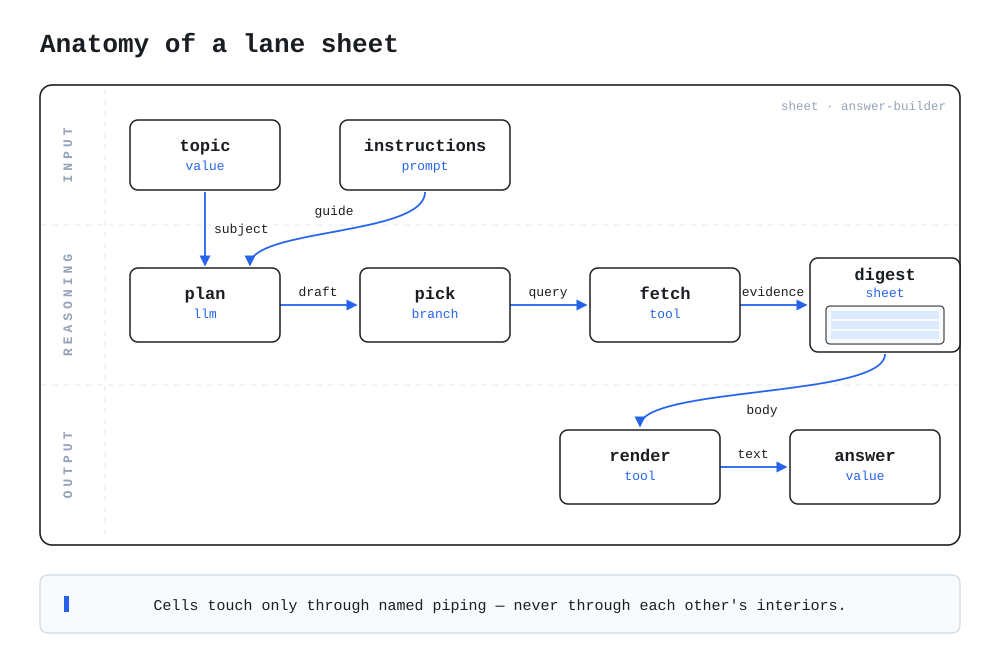

# gitpp-dogfood-sheet

**A small, complete, reusable agent workflow — the `word-frame` sheet, applied to two texts and joined — stored as git.pp records and derived in CI by the public [gitpp-action](https://github.com/patchwork-quilt/gitpp-action): the sheet is the state, and the fold is how you read it.** For builders evaluating git.pp or lane sheets who want one repo they can clone, re-derive offline, and check against CI's answer.

## Run it (30 seconds)

```bash
git clone https://github.com/patchwork-quilt/gitpp-dogfood-sheet
cd gitpp-dogfood-sheet
sh tools/check.sh
# records: generated set regenerates byte-identically
# fold: committed records fold to the expected state
# CHECK PASS
```

That script regenerates the records under `.gitpp/records/` from the source sheet in `fixtures/` and re-folds them locally (`tools/derive.py`) — proving the committed records are exactly what the source sheet generates, and that they fold to exactly the state committed in `tools/expected-fold.json`. CI runs the same check on every push (`.github/workflows/check.yml`), and the gitpp-action derives the state on every push (`.github/workflows/gitpp.yml`). The two derivations — the Action's real engine in CI, the vendored fold offline — agree; the run table below is the record.

## The workflow

`fixtures/word-frame.sheet.json` is a small reusable workflow — the plugin:

- `input.text` — a text, bound by whoever invokes the sheet;
- `work.count` — a `wordcount` tool cell over that text;
- `output.report` — a prompt cell framing the result: `counted: {{count}}`.

Frame a text, count its words, report the count in the frame.

`fixtures/sheet-reused.sheet.json` is the project built on it. Three lanes: a first lane pipes the text *"the active ledger"* (`input.a`) into the inner sheet (`use.first`, naming `word-frame`); a second lane does the same with *"only the piping is public"* (`input.b` → `use.second`); a join lane's prompt cell (`join.summary`) combines the two framed reports with the template `A: {{first}} | B: {{second}}`. One inner sheet, two invocation sites — reuse is the plugin shape, and `join.summary` is the sheet's declared output.



The same sheet drawn live — editable, runnable in the browser — is on the lane-sheets deployment page: <https://superinstance.github.io/lane-sheets/> (pick the `sheet-reused` fixture).

## The model

**Sheet → records.** `fixtures/sheet-reused.sheet.json` is the source of truth. `tools/sheet_to_records.py` (vendored from the lane-sheets spike, attribution in its header) compiles it into the six records under `.gitpp/records/`:

- one **genesis record** (`sheet-sheet-reused`) carrying the sheet-level facts under `sheet.*` keys — id, format version, title, declared outputs, and `sheet.lanes`, the lane structure carried as data because lane membership is presentation, not derivation;
- one **record per cell** (`cell-<id>`), each setting `cell.<id>.kind`, `cell.<id>.def` (the payload), and `cell.<id>.inputs` (the port map);
- a cell record's **parents are its piping ancestry** — the records of the cells it pipes from, or the genesis record when it pipes from nothing. The record DAG is the dataflow DAG, so the fold's ancestry rules operate on the piping graph itself.

The referenced inner sheet stays a **reference by name**: `word-frame`'s own records are not inlined here; in a full install they would land alongside as a separate record set compiled by the same tool.

**Records → state.** State is never stored; it is derived by the fold, under declared rules: kind first (override beats task beats witness), within a kind a record that descends from a rival supersedes it, remaining ties break on ancestry cleanliness. The fold here is mechanical resolution of labelled key conflicts only; digests authenticate content, not authorship; arrival order is never an input. In CI the Action runs the production engine; offline, `tools/derive.py` runs the vendored minimal port (`tools/fold.py`, byte-identical to the spike's) — on this repo's records the two agree key-for-key.

**Changing a cell.** A definition is never edited in place. To change one cell, land a new record that sets that cell's `.def` key: an `override`-kind record wins by class, and a `task`-kind record that *descends from* the cell's record — it saw the definition and built on it — wins by ancestry. The fold reports the contest (winner and losers, by name), the superseded definition stays in the record set and in git history, and removing the new record restores the original exactly. Nothing is mutated; everything is superseded or restored by re-derivation.

### The override episode

That mechanism is not hypothetical here — it happened, in the open. [PR #1](https://github.com/patchwork-quilt/gitpp-dogfood-sheet/pull/1) landed exactly one record, `cell-join-summary-2` (kind `task`, parent `cell-join.summary`), redefining `join.summary`'s template from `A: {{first}} | B: {{second}}` to the terser `{{first}} | {{second}}` — the lane structure already says which report is which. The merge derivation (run [40394845252](https://github.com/patchwork-quilt/gitpp-dogfood-sheet/actions/runs/40394845252), below) reported **7 records · 20 keys · 1 conflict · 0 orphans**: the conflict on `cell.join.summary.def` names winner `cell-join-summary-2` and loser `cell-join.summary`, "the winner descends from it", and a mechanical diff against the pre-episode state shows **exactly one key changed** — the other nineteen identical. The Action's state equals the local fold's on all 20 keys; `tools/expected-fold.json` carries the post-episode expectation, so `tools/check.sh` proves the current record set on every push. Delete `cell-join-summary-2.json` (restoring the prior expectation) and the original template returns: nothing was ever edited.

## Derivation runs

Every push re-derives. The runs that changed — or first proved — the state:

| Run | Commit | Records · Keys · Conflicts · Orphans | What it showed |
|---|---|---|---|
| [40361763003](https://github.com/patchwork-quilt/gitpp-dogfood-sheet/actions/runs/40361763003) | `c9e333c` | 6 · 20 · 0 · 0 | First derivation. The Action's state matched an independent local fold of the same records on **20/20 keys**, and matched the prediction the README of the day had written before the run. One nuance, recorded rather than smoothed: the report's qualifications line carries a fourth, glossary sentence in the v0.3.1 renderer that the prediction's quote did not include; no derived value was affected. |
| [40394631191](https://github.com/patchwork-quilt/gitpp-dogfood-sheet/actions/runs/40394631191) | `16a5b86` | 6 · 20 · 0 · 0 | The project-furniture push: the records did not change, and CI re-derived the identical state; the new records-check workflow (run 40394631371) passed alongside. |
| [40394845252](https://github.com/patchwork-quilt/gitpp-dogfood-sheet/actions/runs/40394845252) | `8f84da8` | 7 · 20 · 1 · 0 | The override episode (merge of PR #1). `cell-join-summary-2` superseded `join.summary`'s template; the conflict names winner and loser, and exactly one of the 20 derived keys changed. The records check (run 40394845305) passed on the same push. |

## Honest limits

- **Derivation yields the sheet's definition, not an execution.** The fold proves the workflow survives being stored as records and reconstructed by rule. Running it — interpreter, hosts, live models — is the lane-sheets engine's job, upstream of the fold.
- **`tools/fold.py` is a labelled minimal port** of the fold's derive semantics; the conformance-grade engine is the one the Action vendors from git.pp-ng. Claims here need only the ported subset, and CI cross-checks it on every push.
- **Uninstalling is not a fold operation.** The fold has no deletion semantics; a record set is withdrawn by removing its files (a git operation) or superseded cell-by-cell, never silently erased by derivation.

## Layout

| Path | What it is |
|---|---|
| `fixtures/sheet-reused.sheet.json` | The source sheet — the project. Source of truth for the records. |
| `fixtures/word-frame.sheet.json` | The reusable inner sheet the project applies twice. |
| `.gitpp/records/` | The compiled records: six generated from the source sheet, plus any hand-landed records (see CHANGELOG). |
| `tools/sheet_to_records.py` | Vendored compiler: sheet → records. |
| `tools/derive.py` + `tools/fold.py` | The offline fold: records → derived state. |
| `tools/expected-fold.json` | The fold result the committed records must reproduce. |
| `tools/check.sh` | Regeneration + fold check; also a CI workflow. |
| `docs/anatomy.svg` | The anatomy diagram (from SuperInstance/lane-sheets). |
| `.github/workflows/gitpp.yml` | On push: derive the state with the public gitpp-action. |
| `.github/workflows/check.yml` | On push: run `tools/check.sh`. |

## The family

- [SuperInstance/lane-sheets](https://github.com/SuperInstance/lane-sheets) — agent workflows as sheet data; the fixtures this repo encodes, and the spike (`gitpp/`) that defined the records mapping.
- [patchwork-quilt/gitpp-action](https://github.com/patchwork-quilt/gitpp-action) — the Action this repo's CI runs: the git.pp fold over a directory of records, reported as an advisory summary.
- [patchwork-quilt/git.pp-ng](https://github.com/patchwork-quilt/git.pp-ng) — the specification and engine the Action vendors.

Licence: MIT — SuperInstance.
